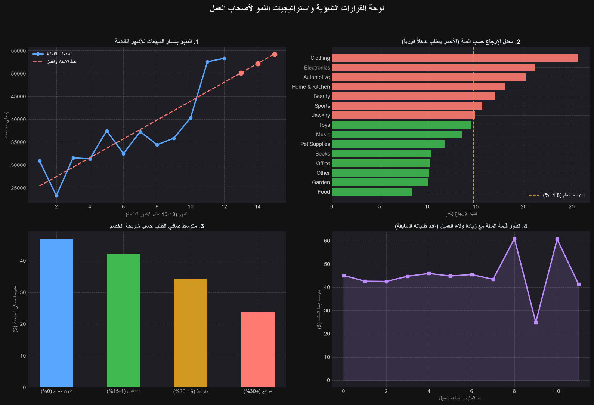

# 🛒 E-Commerce Orders: Exploratory Data Analysis & Predictive Insights

> An end-to-end data analysis project exploring e-commerce order transactions, customer behaviors, product returns, and future sales trend forecasting using Python.


---

## 📋 Table of Contents
- [Project Overview](#project-overview)
- [Dataset Features](#dataset-features)
- [Data Cleaning & Preprocessing](#data-cleaning--preprocessing)
- [Key Exploratory Data Analysis (EDA)](#key-exploratory-data-analysis-eda)
- [Predictive Insights & Business Recommendations](#predictive-insights--business-recommendations)
- [Data Visualizations (Dark Mode Dashboard)](#data-visualizations-dark-mode-dashboard)
- [Technologies & Libraries Used](#technologies--libraries-used)
- [How to Run the Code](#how-to-run-the-code)

---

## 🚀 Project Overview
In today’s competitive e-commerce ecosystem, leveraging data is crucial for maximizing net revenue and optimizing operations. This project investigates a dataset of **10,035 orders** across **20 variables**[cite: 1]. The goal is to transition from descriptive analysis (what happened) to predictive and prescriptive insights (what will happen and what actions to take).

---

## 📊 Dataset Features
The dataset includes key attributes such as:
* **Customer Information:** `customer_id`, `customer_age`, `country`, `signup_date`
* **Order Details:** `order_id`, `order_date`, `product_category`, `payment_method`, `device_type`
* **Financial Metrics:** `unit_price`, `quantity`, `discount_pct`, `shipping_cost`, `refund_amount`
* **Operational Metrics:** `is_returned`, `return_reason`, `customer_support_ticket_after_order`

---

## 🧹 Data Cleaning & Preprocessing
Before diving into analysis, the data underwent rigorous cleaning:
1. **Datetime Conversion:** Converted `order_date` and `signup_date` from string objects to proper `datetime` format.
2. **Missing Value Imputation:** 
   * Handled missing entries in `country` and `device_type` by filling them with `"Unknown"`.
   * Logically mapped missing values in `return_reason` and `refund_amount` to `"Not Returned"` and `0.0` for non-returned orders.
3. **Feature Engineering:** Created a net **`Total_Sales`** column incorporating unit price, quantity, and discount percentages, alongside time-based features (`Month`, `Year`, `Day_Name`).

---

## 🔍 Key Exploratory Data Analysis (EDA)
* **Transaction Scale:** Analyzed **10,035 valid records** with zero duplicates[cite: 1].
* **Pricing & Basket Size:** Average unit price stands at **$27.44** with an average purchase quantity of **1.69 items** per order[cite: 2].
* **Return Rate Alert:** Approximately **17.3%** of orders were returned, resulting in an average refund of **$42.60** per return, highlighting a primary area for loss prevention[cite: 1, 2].

---

## 💡 Predictive Insights & Strategic Recommendations
1. **Mitigate Return Losses:** Focus strict quality control on categories exceeding the 17.3% average return rate to directly recover thousands in revenue[cite: 1].
2. **Optimize Discount Tiers:** Avoid aggressive discounting (+30%) as data shows diminishing returns on net order value; shift focus to targeted 10%-15% discounts.
3. **Sales Forecasting:** Utilized linear regression trendlines to project future monthly revenues, enabling proactive inventory management ahead of peak seasons.
4. **Customer Retention:** Identified strong correlation between customer tenure/repeat orders and higher basket value, recommending a dedicated loyalty rewards program.

---

## 📈 Data Visualizations (Dark Mode Dashboard)
The project features professional multi-plot data dashboards designed with a clean, eye-friendly **Dark Mode** theme (`dark_background`), featuring:
* Horizontal bar charts for category-wise sales.
* Donut charts illustrating payment method distributions.
* Trendline analysis with polynomial fitting for future sales forecasting.
* Multi-variable scatter plots comparing shipping costs against order value.

---

## 🛠️ Technologies & Libraries Used
* **Python** (Core Programming)
* **Pandas** & **NumPy** (Data Manipulation & Statistical Aggregation)
* **Matplotlib** (Advanced Data Visualization & Dashboard Layouts)
* **Jupyter Notebook** (Development Environment)

---

## ⚙️ How to Run the Code
1. Clone this repository to your local machine:
   ```bash
   git clone [https://github.com/nada-aldubaie2/ecommerce-orders-analysis.git](https://github.com/your-username/ecommerce-orders-analysis.git)
